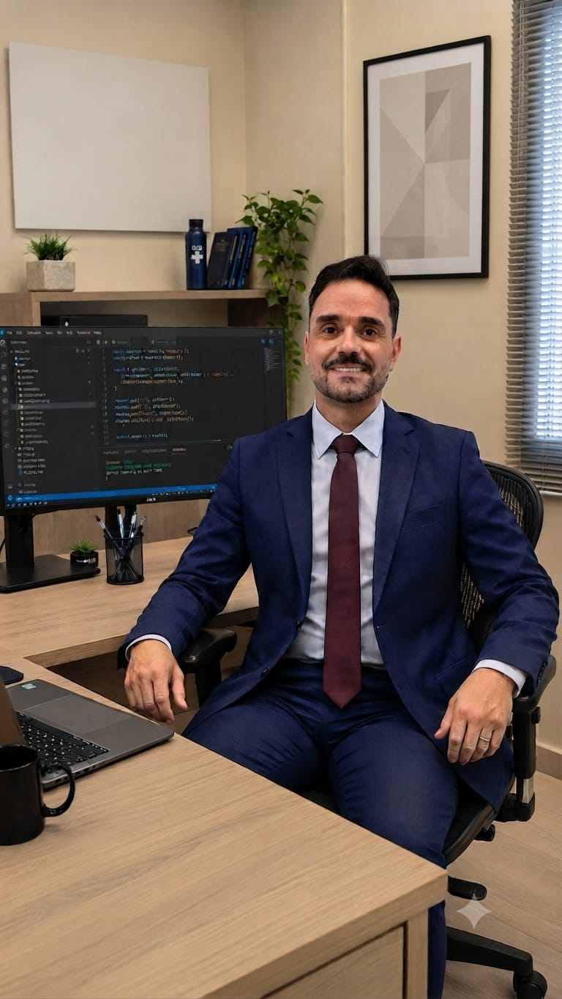
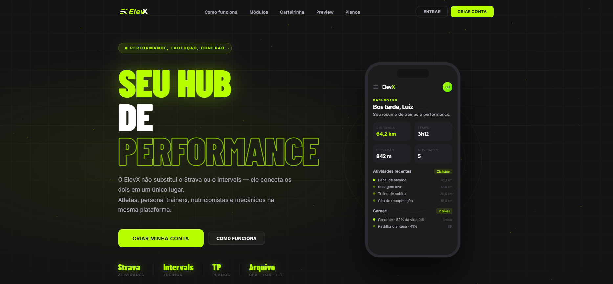
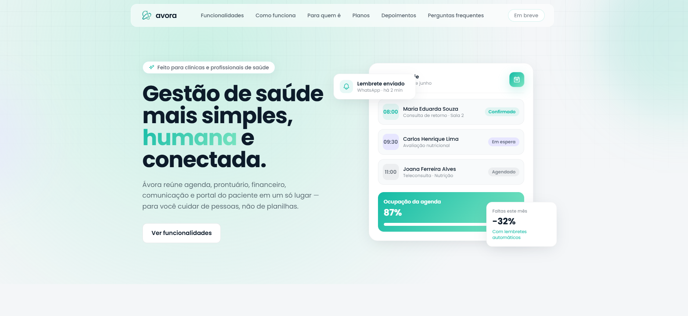
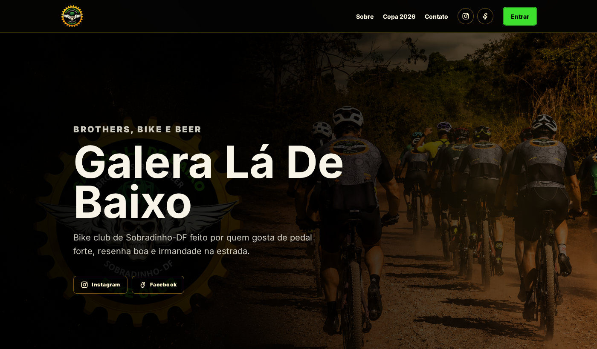

# Olá, eu sou o Luiz Henrique 👋

**Desenvolvedor Full Stack · AI-Augmented Developer · Brasília-DF**

Construo sistemas web, painéis de dados e automações com IA — do levantamento de requisitos ao deploy.

---

## 🧭 Sobre mim

- 🏛️ **7+ anos** desenvolvendo sistemas para a **saúde pública** no Ministério da Saúde
- 🐘 Base sólida em **PHP 8+ / Laravel**, com **Python (Django)** e **Next.js / React**
- 🤖 Integro **LLMs, agentes e automações inteligentes** em produtos reais
- 📊 Especialista em **indicadores e dashboards** de dados conectados a PostgreSQL, MySQL e SQL Server
- 💼 Atendo como **freelancer** empresas e profissionais liberais

## 🚀 Projetos em destaque

<table>
<tr>
<td width="50%" valign="top">

### [ElevX](https://elevx.app.br/)

Ecossistema para atletas e profissionais do esporte: treino, nutrição, garagem de bikes, oficina e clubes, integrado a Strava e Intervals.icu.

`PHP 8.3` `Vue 3` `PWA` `Multi-tenant`

</td>
<td width="50%" valign="top">

### [Avora](https://avora.med.br/)

Gestão para clínicas e profissionais de saúde: agenda, prontuário eletrônico, prescrições, farmácia e financeiro.

`Laravel 10` `React` `Multi-tenant`

</td>
</tr>
<tr>
<td width="50%" valign="top">

### [PRO1 System](https://pro1system.com.br/)

Gestão para empresa de eventos audiovisuais: agenda, clientes, repertório integrado ao Spotify e catálogo de equipamentos.

`PHP` `Spotify API`

</td>
<td width="50%" valign="top">

### [Bruno Caixeta](https://brunocaixeta.com.br/)

PWA para personal de ciclismo: alunos, treinos via Intervals.icu, sync com Strava, financeiro e push notifications.

`PWA` `Strava` `Intervals.icu`

</td>
</tr>
<tr>
<td width="50%" valign="top">

### [CIH Brasil](https://cihbrasil.com/)

Site institucional para clínica de saúde mental, com serviços, convênios e contato rápido via WhatsApp.

</td>
<td width="50%" valign="top">

### [Galera Lá de Baixo](https://galeraladebaixo.com.br/)

Site oficial de bike club de Sobradinho-DF: comunicação do grupo, eventos e redes sociais.

</td>
</tr>
</table>

## 🏢 Experiência

**Desenvolvedor Full Stack Python** — FIOTEC · Ministério da Saúde (DJUD/SE) · *dez/2024 – atual*
Django + Next.js com DS GOV BR, PostgreSQL e Docker. Solução implantada em todo o território nacional.

**Desenvolvedor Full Stack PHP** — Consultoria OPAS/OMS · SVSA/DATHI · Ministério da Saúde · *mar/2019 – atual*
Sistemas de vigilância epidemiológica, dashboards, integração com SQL Server e modernização de legados para PHP 8+.

## 🛠️ Stack

  
    
  

**IA & LLMs:** Claude · APIs de LLM · agentes · automações · engenharia de prompt

## 💡 Serviços

| | |
|---|---|
| 🌐 **[Seu Negócio na Web](https://luizhenrique.dev.br/seu-negocio-na-web/)** | Landing page profissional com domínio e hospedagem por 12 meses para médicos, advogados, psicólogos, dentistas, personal trainers e nutricionistas |
| 🧩 **Sistemas sob medida** | Aplicações completas em Laravel, Symfony, Django e Next.js |
| 📈 **Dashboards** | Indicadores, relatórios e visualizações interativas |
| 🤖 **IA em produtos** | LLMs via API, agentes, extração e classificação de dados |
| ☁️ **Infra & deploy** | Linux na DigitalOcean, Docker, Nginx e CI/CD |

---

📫 **Bora conversar?** [luizmorais@gmail.com](mailto:luizmorais@gmail.com) · [luizhenrique.dev.br](https://luizhenrique.dev.br/)

