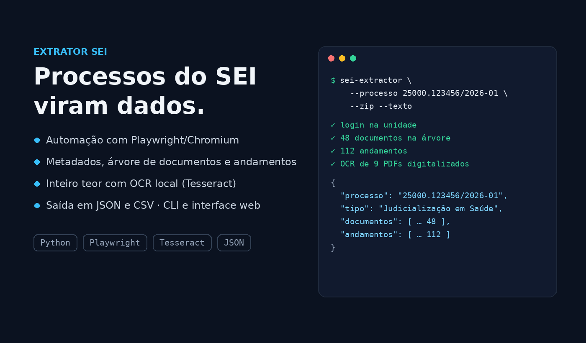
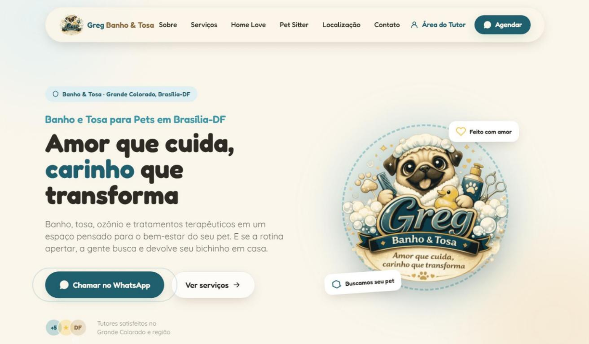
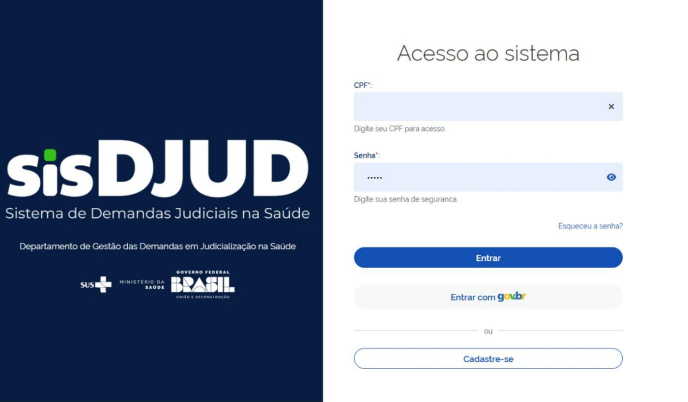

# Olá, eu sou o Luiz Henrique 👋

**Desenvolvedor Full Stack · Analista de Dados · IA Aplicada** 
📍 Brasília-DF

Construo sistemas web, painéis de dados e automações com IA para a saúde pública e para negócios — do levantamento de requisitos ao deploy.

---

## 🧭 Sobre mim

- 🏛️ **7+ anos** desenvolvendo sistemas, indicadores e painéis para a **saúde pública** no Ministério da Saúde
- 🐘 Stack principal: **PHP 8+**, **Python** e **Next.js / React**, com o design system **DS GOV BR**
- 🤖 Integro **LLMs, RAG, agentes e automações inteligentes** em produtos reais
- 📊 Especialista em **indicadores e dashboards** de dados conectados a PostgreSQL, MySQL e SQL Server
- 🖥️ Base sólida em **infraestrutura de TI**: Linux, Docker, Nginx e CI/CD
- 💼 Atendo como **freelancer** empresas e profissionais liberais

## 🚀 Apps que desenvolvi

<table>
<tr>
<td width="50%" valign="top">

### [ElevX](https://elevx.app.br/)

Ecossistema para atletas e profissionais do esporte: treino, nutrição, garagem de bikes, oficina e clubes, integrado a Strava e Intervals.icu.

`PHP 8.3` `Vue 3` `PWA` `Multi-tenant`

</td>
<td width="50%" valign="top">

### [Avora](https://avora.med.br/)

Gestão para clínicas e profissionais de saúde: agenda, prontuário eletrônico, prescrições, farmácia e financeiro.

`Laravel 10` `React` `Multi-tenant`

</td>
</tr>
<tr>
<td width="50%" valign="top">

### [Quem Paga o Quê](https://quempagaoque.com.br/)

Contas compartilhadas do casal ou do grupo: cada um lança o que pagou e, no fim do mês, o app diz quem faz o Pix para quem — até o centavo.

`PHP 8.3` `Vue 3` `Tailwind 4` `PWA` `PHPUnit`

</td>
<td width="50%" valign="top">

### Extrator SEI

Raspagem de processos do SEI com navegador automatizado, OCR e LLMs + RAG para extrair e estruturar metadados, documentos e andamentos — base dos painéis de apoio jurídico do Ministério da Saúde.

`Python` `Playwright` `LLMs` `RAG` `Tesseract OCR`

</td>
</tr>
<tr>
<td width="50%" valign="top">

### [PRO1 System](https://pro1system.com.br/)

Gestão para empresa de eventos audiovisuais: agenda, clientes, repertório integrado ao Spotify e catálogo de equipamentos.

`PHP` `Spotify API`

</td>
<td width="50%" valign="top">

### [Bruno Caixeta](https://brunocaixeta.com.br/)

PWA para assessoria de ciclismo: alunos, treinos via Intervals.icu, sync com Strava, financeiro e push notifications.

`PHP` `PWA` `Strava` `Intervals.icu`

</td>
</tr>
<tr>
<td width="50%" valign="top">

### [Greg Banho & Tosa](https://gregpet.com.br/)

Site do pet shop + Área do Tutor: cadastro de tutores e pets, login e painel administrativo para a equipe.

`Laravel 13` `Filament 5` `Tailwind 4` `Alpine.js`

</td>
<td width="50%" valign="top">

### SisDJUD

Sistema das Demandas em Judicialização na Saúde (DJUD/Ministério da Saúde), em uso em todo o país: monitoramento de demandas judiciais, análise farmacêutica, logística de entregas e gestão de acesso com login gov.br.

`Django 5` `DRF` `Next.js 14` `DS GOV BR` `PostgreSQL` `Cypress`

</td>
</tr>
</table>

## 🏢 Experiência

**Analista de Dados** — FIOTEC · Projeto Desid/SE · Ministério da Saúde · *out/2026 – atual* 
Painéis de dados e aplicações em PHP 8+ e Python com DS GOV BR. Criação do Extrator SEI (LLMs + RAG) e painéis que apoiam respostas jurídicas e decisões internas. Projetos Instituições Filantrópicas, ApuraSUS, BPS (Banco de Preços em Saúde), CATMAT e Painel Jurídico.

**Desenvolvedor Full Stack Python** — FIOTEC · Projeto DJUD/SE · Ministério da Saúde · *dez/2024 – set/2026* 
SisDJUD em Django + Next.js com DS GOV BR, modelagem em PostgreSQL, indicadores em Python, Docker e deploy via GitLab. Solução usada em todo o território nacional.

**Desenvolvedor Full Stack PHP** — OPAS/OMS · SVSA/DATHI · Ministério da Saúde · *mar/2019 – atual* 
Sistemas e dashboards de vigilância de ISTs, HIV/Aids, hepatites, hanseníase e tuberculose. Relatórios em PDF, Chart.js, SQL Server e modernização de legados para PHP 8+ com .env e Docker.

**Infraestrutura & projetos freelance** — *atividade contínua* 
Servidores Linux na DigitalOcean, Nginx, Docker e pipelines de CI/CD para clientes.

<b>Experiências anteriores e formação</b>

 

- Analista de Infraestrutura Sênior — Cast Informática S.A. · *2017 – 2019*
- Técnico de Suporte CI2 — Link Data Informática e Serviços S.A. · *2014 – 2016*
- Técnico de Suporte — UniCEUB · *2008*

🎓 Pós-graduação em Docência em Ciência e Tecnologia da Informação — UniBF · *2019* 
🎓 Pós-graduação em Gerenciamento de Projetos em TI — FACEL · *2016 – 2017* 
🎓 Bacharelado em Sistemas de Informação — Faculdade Projeção · *2010 – 2015*

## 🛠️ Stack

  
    
  

**IA aplicada:** LLMs via API · RAG · agentes · automações inteligentes · Claude

## 💡 Serviços

| | |
|---|---|
| 🌐 **[Seu Negócio na Web](https://luizhenrique.dev.br/seu-negocio-na-web/)** | Landing page profissional com domínio e hospedagem por 12 meses para médicos, advogados, psicólogos, dentistas, personal trainers e nutricionistas |
| 🧩 **Sistemas sob medida** | Aplicações completas em Laravel, Symfony, Django e Next.js |
| 📈 **Análise de dados e painéis** | Indicadores, relatórios e visualizações interativas sobre PostgreSQL, MySQL e SQL Server |
| 🤖 **IA em produtos** | LLMs via API, RAG, agentes, extração e classificação de dados |
| ☁️ **Infra & deploy** | Linux na DigitalOcean, Docker, Nginx e CI/CD |

---

📫 **Bora conversar?** [luizmorais@gmail.com](mailto:luizmorais@gmail.com) · [luizhenrique.dev.br](https://luizhenrique.dev.br/)

